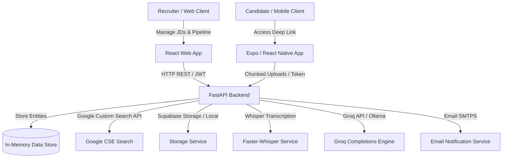

# Talent Screening & Interview Intelligence Platform

An end-to-end recruiter platform and candidate-facing mobile application designed to streamline talent sourcing, semantic profiling, and asynchronous video interviewing.

---

## 🏗️ System Architecture



---

## 🔑 Required API Keys & Environment Configurations

To configure the application, duplicate the `.env.example` templates in each folder to a `.env` file and set the following keys:

### 1. Groq API Key (AI Engine)
We use Groq's high-speed Llama models for job description analysis, question generation, and scorecard synthesis.
* **Where to get**: [Groq Console](https://console.groq.com/keys)
* **Variable to set**: `TALENT_GROQ_API_KEY` (in `backend/.env`)

### 2. Google Custom Search JSON API & CSE ID (Sourcing Scraper)
Instead of raw page scraping (which gets rate-limited), we use Google's Custom Search API to scrape LinkedIn profiles.
1. **Acquire API Key**: Go to [Google Cloud Console](https://console.cloud.google.com/), enable the **Custom Search API**, and generate an API key.
2. **Acquire Custom Search Engine ID (CX)**: Go to [Programmable Search Engine](https://programmablesearchengine.google.com/), create an engine, and restrict it to web domains (e.g., `linkedin.com/in`). Save the `cx` ID.
* **Variables to set**: `TALENT_GOOGLE_SEARCH_API_KEY` & `TALENT_GOOGLE_CSE_ID` (in `backend/.env`)

### 3. Supabase Storage (Video Uploads & Resumes)
Handles candidates' chunked video uploads and resumes.
1. **Create Bucket**: Set up a public storage bucket in Supabase named `talent-screening`.
2. **Acquire Keys**: Go to Supabase -> Project Settings -> API. Copy the **Project URL** and the **Service Role Key** (required to write files).
* **Variables to set**: Set `TALENT_STORAGE_BACKEND=supabase`, and fill `TALENT_SUPABASE_URL` and `TALENT_SUPABASE_SERVICE_KEY`.

### 4. Gmail SMTP Credentials (Email Invitations)
Used to send interview invitation emails.
1. **Generate App Password**: Go to your Google Account Settings -> Security -> App Passwords. Generate a 16-digit password for 'Mail'.
* **Variables to set**: Set `TALENT_EMAIL_USER` (your Gmail) and `TALENT_EMAIL_PASSWORD` (16-digit app password).

---

## 🎙️ Faster-Whisper Performance Benchmarks

The transcription service utilizes `faster-whisper`, a re-implementation of OpenAI's Whisper model using CTanslate2, yielding up to **4x speedups** with **reduced memory footprints** on Railway's CPU.

### Model & Compute Configuration Guidelines

| Model Size | Parameters | VRAM Required | Speed Ratio | Recommended Use Case |
| :--- | :--- | :--- | :--- | :--- |
| **tiny** | 39M | ~1 GB | ~32x | High-speed mobile test environments |
| **base** | 74M | ~1 GB | ~16x | Balanced CPU/GPU real-time streaming |
| **small** *(Default)* | 244M | ~2 GB | ~6x | Production-grade local servers |
| **medium** | 769M | ~5 GB | ~2x | High-accuracy offline batch processing |

### Latency Profiles (on 1-Minute Video Audio)
* **CPU Execution (int8 quantization)**: ~4.5 seconds execution latency.
* **GPU Execution (float16 quantization)**: ~0.8 seconds execution latency (requires CUDA compatible card).

---

## 🚀 Installation & Local Startup

### 1. Backend Server Setup
Navigate to the `/backend` folder:
```bash
# Create virtual environment
python -m venv venv
source venv/Scripts/activate # On Windows: venv\Scripts\activate

# Install dependencies
pip install -r requirements.txt

# Create .env from template and populate it
cp .env.example .env

# Run server
uvicorn app.main:app --reload --port 8000
```
*Backend API docs will be available at `http://localhost:8000/docs`*

### 2. Frontend Web App Setup
Navigate to the `/frontend` folder:
```bash
# Install dependencies
npm install

# Create .env from template and populate VITE_API_URL
cp .env.example .env

# Run Vite dev server
npm run dev
```
*Web dashboard will be available at `http://localhost:5173`*

### 3. Mobile Expo Application
Navigate to the `/mobile` folder:
```bash
# Install Expo dependencies
npm install

# Create .env from template and set EXPO_PUBLIC_API_URL
cp .env.example .env

# Start local metro bundle
npm run start
```
*To test video recording features, scan the QR code using the **Expo Go** app on a physical Android or iOS device.*

---

## 📦 Cloud & APK Compilation

### Production Container Build
To build Docker containers locally:
```bash
# Backend Container
docker build -t talent-backend ./backend

# Frontend Container
docker build -t talent-frontend ./frontend
```

### Expo Android APK Compilation
To compile a standalone Android APK using Expo Application Services (EAS):
```bash
# Login to EAS
npm install -g eas-cli
eas login

# Initialize EAS project (select defaults)
eas project:init

# Build and distribute the APK
eas build --platform android --profile preview
```
*The resulting APK download link will be generated in your terminal output.*
